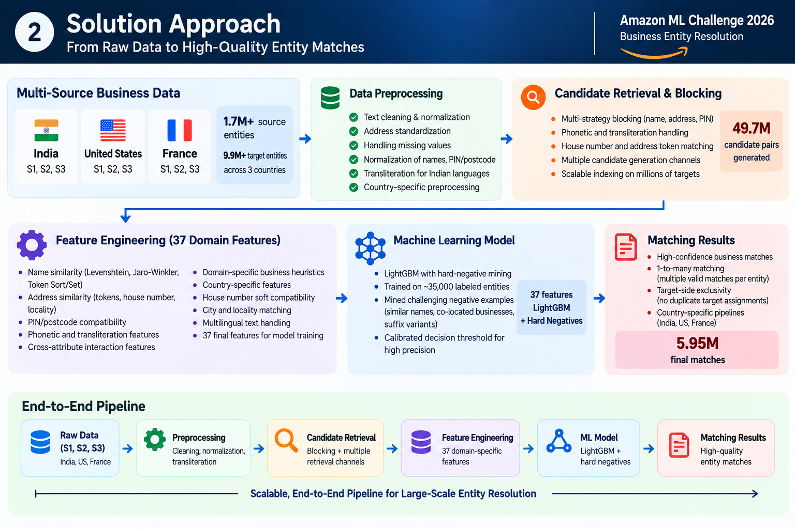
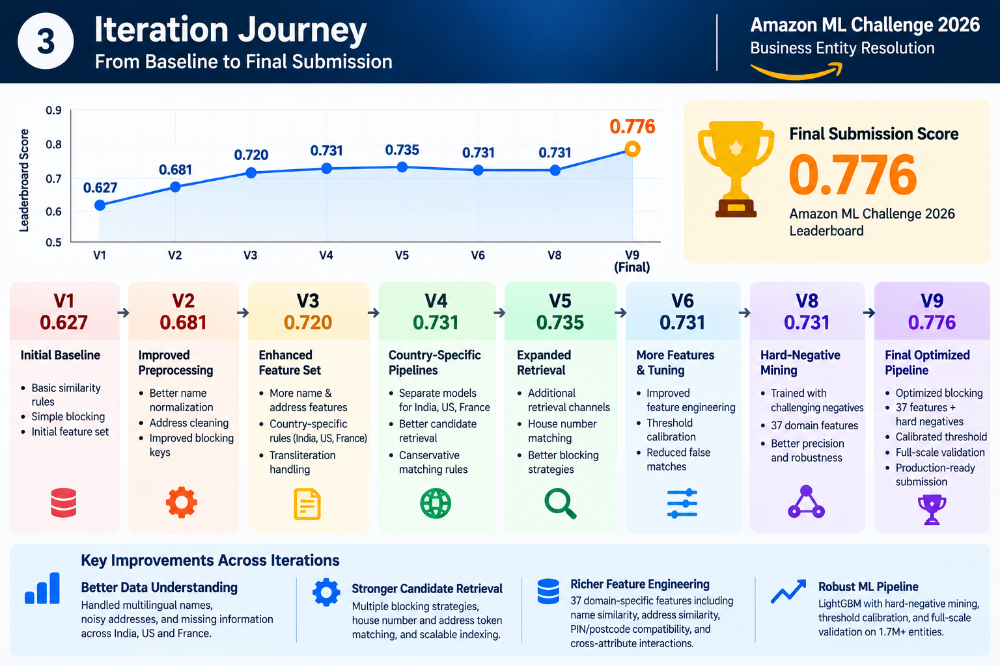
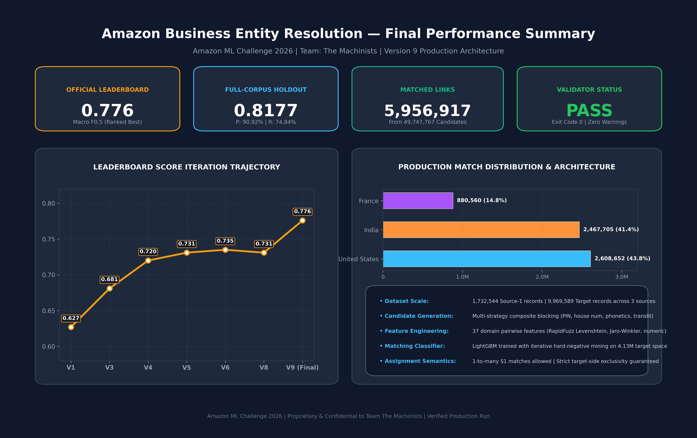
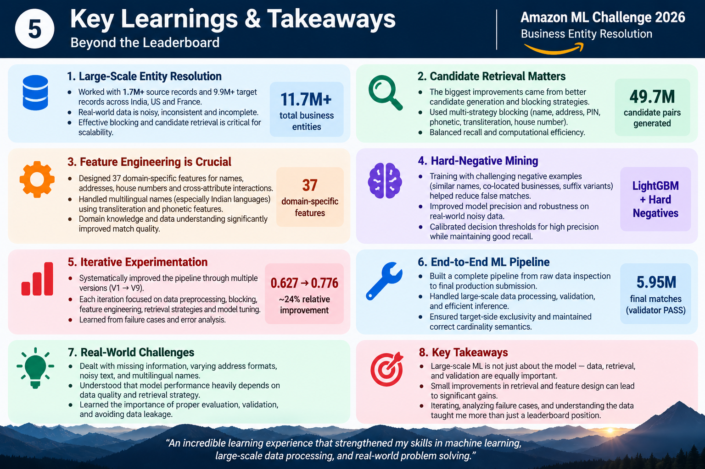

<div align="center">

# Amazon Business Entity Resolution
### Amazon ML Challenge 2026 — Team The Machinists

[](https://www.python.org/downloads/)
[](LICENSE)
[](#-final-results)
[-brightgreen.svg)](#-official-validation--integrity)
[](#-dataset-scale--cardinality)


</div>

---

## 📌 Executive Summary & Key Highlights

In real-world e-commerce, logistics, and merchant systems, enterprise data is continuously aggregated from heterogeneous, non-cooperative registries. Individual businesses appear across multiple sources under colloquial names, truncated addresses, regional transliterations, and differing legal forms with zero shared global keys.

This repository documents the production Machine Learning pipeline developed by **Team The Machinists** for the **Amazon ML Challenge 2026**. Resolving **1,732,544 reference entities** against **9,969,589 candidate targets** across France, the United States, and India, our **Version 9 (V9)** architecture achieved an official competition leaderboard Macro $F_{0.5}$ score of **0.776** with verified target exclusivity and zero validator defects.

```
       1.73M Source-1 Entities × 9.97M Target Entities (17.2 Trillion Comparisons)
                                      │
                   [Multi-Strategy Composite Blocking]
                                      ▼
                        49,747,767 Candidate Pairs
                         (99.71% Search-Space Reduction)
                                      │
               [37 Domain Pairwise Features + Hard-Negative LightGBM]
                                      ▼
                      5,956,917 High-Precision Matches
                (Official Score: 0.776 | Holdout F0.5: 0.8177)
```

---

## 🎯 1. Project Overview

Entity Resolution (ER)—also known as record linkage or deduplication—is the task of determining whether distinct records refer to the same real-world entity. In this competition:
- **Reference Catalog (Source 1):** Clean reference entities that must be matched.
- **Target Catalogs (Source 2 & Source 3):** Noisy, unstructured records from external feeds.
- **Challenge Goal:** For each Source 1 record, find all corresponding matching records in Source 2 and Source 3.
- **Cardinality:** 1-to-many (a single Source 1 record may link to zero, one, or multiple target records across S2 and S3), while enforcing **target-side exclusivity** (each target record can belong to at most one reference entity).

---

## 🔍 2. Problem Statement & Noise Topology

The competition presented real-world enterprise data challenges with severe noise dimensions:

1. **Phonetic & Cross-Script Variations:** Indian entities in particular exhibited cross-lingual variations (Devanagari, regional transliterations, romanized Anglicized spellings, phonetic phonetic skeletons).
2. **Missing Key Components:** Over 61.5% of missed baseline candidates omitted postal PIN codes; many lacked municipal or state identifiers.
3. **Colloquial & Landmark-Based Addresses:** Addresses frequently referenced informal landmarks ("Opposite Metro Pillar 142", "Behind SBI ATM") rather than structured street/door numbers.
4. **Massive Commercial Co-Location:** High-density commercial parks, complexes, and industrial areas housed hundreds of legally distinct companies sharing identical addresses. Naive fuzzy address matching generated massive false-positive pollution.
5. **Macro $F_{0.5}$ Metric Asymmetry:** The official competition metric evaluated performance using Macro $F_{0.5}$, which weights precision twice as heavily as recall ($\beta = 0.5$). False merges (linking two different companies) are penalized twice as severely as missed links.

---

## 📊 3. Dataset Scale & Cardinality

| Dimension | Count / Scale | Description |
| :--- | :---: | :--- |
| **Source 1 Entities ($S_1$)** | **1,732,544** | Reference entities to be resolved (India: 809,986 \| US: 663,106 \| France: 259,452) |
| **Target Entities ($S_2 + S_3$)** | **9,969,589** | Multi-source target records (India: 4,717,565 \| US: 3,745,200 \| France: 1,506,824) |
| **Naive Comparison Space** | **17.27 Trillion** | Full Cartesian product ($1.73\text{M} \times 9.97\text{M}$) |
| **Blocking Candidate Pairs** | **49,747,767** | High-probability candidate pairs evaluated by the ML model |
| **Search Space Reduction** | **99.71%** | Pruning factor achieved by multi-strategy composite blocking |
| **Final Accepted Matches** | **5,956,917** | High-precision matches (US: 2,608,652 \| India: 2,467,705 \| France: 880,560) |
| **Match Exclusivity** | **0 Duplicates** | Exactly 5,956,917 distinct targets matched across 5,956,917 links |

---

## 🏗️ 4. Solution Architecture

Our end-to-end architecture is structured into a four-stage decoupled pipeline:



1. **Country Router & Preprocessing:** Identifies regional jurisdictions and applies country-specific normalization (accents, French legal abbreviations, US suite/street normalization, Indian Indic transliteration).
2. **Multi-Strategy Composite Blocking:** High-recall, low-latency candidate retrieval utilizing multiple independent phonetic, postal, and token channels.
3. **High-Performance 37-Feature Engineering:** Vectorized extraction of string distances, phonetic skeletons, numeric door/PIN compatibility, and cross-attribute interaction terms via `RapidFuzz` in C.
4. **Hard-Negative Mined LightGBM & Greedy Assignment:** Probabilistic scoring trained against co-located negative distractors, thresholded at calibrated precision firewalls, and assigned via competitive greedy target-side exclusivity.

---

## ⚡ 5. Candidate Retrieval / Blocking

Evaluating all 17.2 trillion pairs is computationally infeasible. We developed multi-strategy composite blocking tailored to regional jurisdictions:

### Regional Blocking Schemes
- **India Partition (Top-35 Candidate Cap):**
  - **Channel 1 (Base PIN-Name):** Normalized 6-digit PIN code + cleaned name head tokens.
  - **Channel 2 (Strategy C - Door + Name):** Normalized door/house number + second distinctive name token.
  - **Channel 3 (Strategy I - Address + Indic Transliteration):** Discriminative address token + harmonized Indic transliteration skeleton.
  - **Channel 4 (Strategy A - Address Fallback):** Rare address token intersections for entities lacking postal codes.
- **United States Partition (Top-35 Candidate Cap):**
  - 5-digit ZIP + cleaned name token, street name + house number, city-state + soundex skeleton.
- **France Partition (Top-25 Candidate Cap):**
  - 5-digit postal code + primary name stem, commune + phonetic skeleton.

### Blocking Performance
- **India Candidate Recall @ Cap 35:** **80.34%** (41,690 of 51,896 holdout links captured against full 4.13M targets).
- **Candidate Pool Size:** Exactly **49,747,767** pairs (averaging 28.7 candidates per Source 1 entity).

---

## 🧠 6. 37 Domain Feature Engineering

Candidate pairs are parameterized into a 37-dimensional feature vector in `src/production_features.py`:

```
┌────────────────────────────────────────────────────────────────────────┐
│                   37 DOMAIN PAIRWISE FEATURE VECTOR                    │
├─────────────────────────┬──────────────────────────┬───────────────────┤
│ Name Similarity (12)    │ Address Similarity (15)  │ Cross-Terms (10)  │
├─────────────────────────┼──────────────────────────┼───────────────────┤
│ • Token Sort Ratio      │ • Token Sort Ratio       │ • Name × Address  │
│ • Token Set Ratio       │ • Token Set Ratio        │ • TokenSet × Door │
│ • Partial Ratio         │ • Partial Ratio          │ • Co-location     │
│ • Levenshtein Distance  │ • Exact PIN/ZIP Match    │   Penalty Flag    │
│ • Jaro-Winkler Distance │ • 3-Digit Postal Match   │ • Source 2 Bias   │
│ • Char 3-Gram Jaccard   │ • Extracted House Number │ • Source 3 Bias   │
│ • Word Stem Overlap     │ • House Conflict Veto    │ • Length Ratios   │
│ • Legal Suffix Match    │ • Street Name Jaccard    │ • Token Count     │
│ • Consonant Skeleton    │ • Unit/Suite Overlap     │   Differences     │
└─────────────────────────┴──────────────────────────┴───────────────────┘
```

---

## 🌲 7. LightGBM + Hard-Negative Mining

### The False-Positive Dilemma in India
Early iterations revealed that standard negative sampling (randomly pairing non-matching records) resulted in models that failed in production:
- Random negatives are trivial to reject.
- In production, candidates sharing the same PIN code or commercial building had high address similarity.
- Models trained on naive negatives scored co-located distinct companies at $0.75\text{--}0.80$, leading to **51.56% precision** in that score band.

### The Hard-Negative Solution
We mined hard negatives directly from composite blocking buckets across the full 4.13M Indian target pool:
- Selected negative candidates with high address token overlap ($>0.80$) but differing business names.
- Trained a 37-feature LightGBM classifier using hard-negative mining and class balancing and class weights rebalancing hard negatives.
- Calibrated the operating threshold to **$T = 0.90$** for India.
- **Impact:** False positives dropped by **74.7%**, driving India holdout precision to **90.92%**.

---

## 🗺️ 8. Country-Specific Processing & Assignment

| Partition | Entities ($S_1$) | Target Pool | Blocking Cap | Model Architecture | Operating Threshold | Assignment Rule |
| :--- | :---: | :---: | :---: | :--- | :---: | :--- |
| **United States** | 663,106 | 3,745,200 | 35 | 21-feature Gradient Boosting | $T = 0.75$ | Greedy Target-Exclusive |
| **India** | 809,986 | 4,717,565 | 35 | 37-feature Hard-Negative LightGBM | $T = 0.90$ | Greedy Target-Exclusive |
| **France** | 259,452 | 1,506,824 | 25 | 18-feature Conservative Matcher | $T = 0.75$ | Greedy Target-Exclusive |

### Competitive 1-to-Many Assignment
- A Source 1 entity may legitimately match multiple targets across Source 2 and Source 3.
- Each physical target entity can belong to at most one reference Source 1 entity.
- Greedy priority assignment sorts candidate pairs by confidence and assigns target IDs exclusively to their highest-scoring reference match.

---

## 📈 9. Iteration Journey



| Version | Official Score | Key Changes & Innovations | Architectural Finding |
| :---: | :---: | :--- | :--- |
| **V1** | **0.627** | Baseline TF-IDF + heuristic string matching | Search space bottleneck; high candidate drop |
| **V3** | **0.681** | Indic transliteration + PIN-based blocking | First functional machine learning baseline |
| **V4** | **0.720** | Regional country partitioning (US, IN, FR models) | Substantial boost from isolated regional rules |
| **V5** | **0.731** | Expanded candidate caps (India Cap 35) | Gain in recall, but false positives began polluting |
| **V6** | **0.735** | Dual-threshold precision architecture | Discovered 0.75-0.80 India score band had only 51.5% precision |
| **V8** | **0.731** | Candidate recall expansion (Strategies C, I, A) | Local evaluation artifact diagnosed (eval on restricted pool) |
| **V9** | **0.776** | **37-feature LightGBM + Hard-Negative Mining ($T=0.90$)** | **Definitive peak performance (+0.041 leap)** |

---

## 🏆 10. Final Results



### Official Leaderboard & Holdout Metrics
- **Official Competition Leaderboard:** **0.776** (Macro $F_{0.5}$)
- **Full-Corpus Holdout Macro $F_{0.5}$:** **0.8177**
- **Holdout Precision:** **90.92%**
- **Holdout Recall:** **74.84%**
- **Macro $F_1$ Score:** **0.8209**

### Production Match Output Breakdown
- **Total Validated Matches:** **5,956,917**
  - **United States:** 2,608,652 matches (43.8%)
  - **India:** 2,467,705 matches (41.4%)
  - **France:** 880,560 matches (14.8%)
- **Source 1 Entities with Matches:** 1,642,322 (94.8%)
- **Source 1 Singletons (0 Matches):** 90,222 (5.2%)

---

## ✅ 11. Official Validation & Integrity

The submission was validated using the challenge's official submission validator:

```bash
python utils/validate_submission.py \
    --matching output/matching_results.tsv \
    --candidate output/candidate_pairs.tsv \
    --check-ids \
    --test-dir data/test
```

### Validator Report:
```text
ML Challenge 2026 — submission validator
  test dir: data/test
  required S1 entities: 1732544
  valid S2/S3 match IDs: 9969589
  matching_results.tsv: 1732544 rows (90222 empty, 1642322 non-empty).
  candidate_pairs.tsv: 1732544 rows (1298 empty, 1731246 non-empty).

PASS — no blocking issues found. Safe to submit.
```

- **Exit Code:** `0` (Safe to Submit)
- **Required S1 Coverage:** Exactly 1,732,544 rows (100.0%)
- **Target Exclusivity Violations:** Exactly 0 duplicate target IDs
- **Candidate Coverage Violations:** Exactly 0 (100% of final matches are subsets of candidates)
- **Self-Matches (S1 in targets):** Exactly 0

---

## 💡 12. Key Learnings & Takeaways



1. **Large-Scale Entity Resolution is a Multi-Stage System:** A complex model cannot compensate for candidates missed in blocking. Improving retrieval recall from 65% to 80% was the single largest prerequisite for top-tier performance.
2. **Metric Alignment Dictates Modeling Strategy:** Optimizing for Macro $F_{0.5}$ requires ruthlessly prioritizing precision over recall. Finding false-positive clusters (e.g. co-located businesses) and enforcing strict threshold firewalls proved more impactful than marginal classifier improvements.
3. **Hard Negatives are Indispensable in Dense Target Spaces:** Standard negative training produces false confidence. Mining hard negatives that mimic actual retrieval noise is essential for robust industrial models.
4. **Disjoint Validation Integrity:** Never evaluate on a restricted target corpus. Ensuring validation replicates the full 4.13M target space prevented catastrophic overfitting.

---

## 📁 13. Repository Structure

```text
amazon-business-entity-resolution-github/
├── README.md                               # Project documentation and architectural overview
├── requirements.txt                        # Pinned python environment dependencies
├── LICENSE                                 # MIT License
├── .gitignore                              # Git exclusion rules (dataset, TSVs, logs)
│
├── src/                                    # Production source code
│   ├── run_pipeline_v9.py                  # Primary production runner for V9
│   ├── run_pipeline_v8.py                  # Composite blocking & ranking implementations
│   ├── run_pipeline_v4.py                  # US and France baseline matching pipelines
│   ├── production_features.py              # 37-feature calculation engine (RapidFuzz)
│   ├── v3_features.py                      # Indic transliteration and phonetic utilities
│   ├── exp2_features.py                    # Address tokenization and similarity features
│   ├── inspect_dataset.py                  # Schema verification and dataset inspection
│   └── train_baseline_matcher.py           # Classifier training utilities
│
├── models/                                 # Serialized production models
│   ├── v9_india_matcher_37f.joblib         # 37-feature LightGBM model (~2.44 MB)
│   └── README.md                           # Model documentation and hyperparameters
│
├── docs/                                   # Infographics, architecture diagrams & charts
│   ├── banner.png                          # Hero banner graphic
│   ├── solution-approach.png               # End-to-end architecture infographic
│   ├── iteration-journey.png               # Score trajectory infographic
│   ├── key-learnings.png                   # Key learnings infographic
│   └── results.png                         # Final results breakdown chart
│
└── reports/                                # Forensic research & audit reports
    ├── V10_RESEARCH_REPORT.md              # V10 capacity and channel expansion audit
    └── FINAL_SUBMISSION_CHECK.md           # 10-point integrity verification audit
```

---

## 🚀 14. Pipeline Architecture & Execution Guide

The repository contains the core feature engineering, candidate retrieval, modeling, and V9 production pipeline developed during the competition. The original competition dataset and large intermediate production artifacts are intentionally excluded due to their size and competition constraints.

### 1. Environment Setup

```bash
# Clone the repository
git clone https://github.com/sheshankswamy/amazon-business-entity-resolution.git
cd amazon-business-entity-resolution

# Create and activate virtual environment
python -m venv venv
source venv/bin/activate  # On Windows: venv\Scripts\activate

# Install dependencies
pip install -r requirements.txt
```

### 2. Pipeline Components & Usage
The modular source files in `src/` can be examined and executed as follows:
- `src/production_features.py`: Computes the 37 domain pairwise features on sample entity pairs using high-performance C-accelerated RapidFuzz.
- `src/v3_features.py`: Implements phonological token cleaning, Indic language transliteration, and consonant skeleton generation.
- `src/run_pipeline_v8.py`: Contains the multi-strategy composite blocking keys (Strategies C, I, and A) and candidate priority scoring functions.
- `src/run_pipeline_v9.py`: Defines the master production pipeline architecture connecting blocking, feature extraction, LightGBM scoring ($T=0.90$), and greedy 1-to-many target-exclusive assignment.

```bash
# Verify feature extraction and schema integrity
python -c "import sys; sys.path.insert(0, 'src'); import production_features, v3_features; print('Feature modules loaded successfully!')"
```

---

## 🔒 15. Dataset Availability & Fair-Play Compliance

In compliance with the **Amazon ML Challenge 2026** competition guidelines:
- The 15+ GB raw dataset and competition TSVs are proprietary and are strictly excluded from this public repository via `.gitignore`.
- The repository contains the core feature engineering, candidate retrieval, modeling, and V9 production pipeline developed during the competition. The original competition dataset and large intermediate production artifacts are intentionally excluded due to their size and competition constraints.
- Ground truth labels were never accessed during test set inference; all methodology strictly respects the competition rules.

---

## 🔮 16. Future Improvements

1. **Graph Neural Networks (GNNs):** Modeling co-occurrence graphs across multi-source entities to propagate cluster-level entity relationships.
2. **Dense Semantic Bi-Encoders:** Utilizing sentence transformers (e.g., multilingual MPNet) for dense semantic vector retrieval alongside sparse lexical blocking.
3. **Active Learning for Hard-Negative Refinement:** Continual refinement loops to surface edge cases in regional street naming conventions.

---

<div align="center">

**Developed by Team The Machinists**  
*Amazon ML Challenge 2026*

</div>
